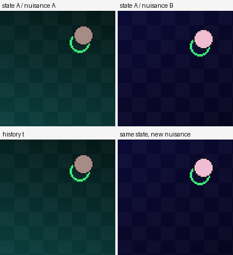

# LeParallax

**Aspect-seeing in action-conditioned world models.**

LeParallax is a small, simulated research project about one question:

> When a world model looks at the world, does it learn the world or the camera?

The name joins two ideas. **Parallax** is the apparent shift in a scene when it is
viewed from two positions: the difference between the views is nuisance, the
invariant is the state. Wittgenstein's **aspect-seeing** is the same image seen
as two different things. The project asks which of the two a learned latent
captures.

This is not a product. It is a controlled experiment with a small model, a
simulated world, and a pre-registered claim. The north star is reliable small
models that learn continually; this chapter is one wedge into that problem.

**Paper draft:** [`docs/PAPER.md`](docs/PAPER.md) — the full write-up, including
the failed endpoints.

---

## The gap

The Platonic Representation Hypothesis says models trained on different
modalities converge to a shared representation of the world. A recent theorem
(Balestriero & LeCun, 2026) makes this precise for JEPAs: if the positive pairs
are **two observations of the same world state** with independent nuisance —
"good views" — then separately trained encoders learn the same representation up
to one rotation. If the positives are corruptions of one observation — crops,
masks, a prefix and its continuation — the encoder spends dimensions on
modality-specific nuisance and aligns only partly.

The theorem has a deliberate hole:

> "the predictor is the identity ... whereas JEPAs used as world models predict
> one embedding from the other through a learned predictor, often conditioned on
> an action, which our analysis does not cover."

That is exactly the regime of LeWM, Dreamer, and every action-conditioned world
model. Their positive pairs are temporal transitions, not same-state views. We
do not know whether good views help a world model, hurt it, or do nothing.

LeParallax tests that hole.

---

## The hypothesis

**Same-state good views make a small action-conditioned world model's latent more
state-like and less nuisance-like, which improves out-of-distribution planning
and reduces forgetting under nuisance shift — without a meaningful
in-distribution regression.**

The mechanism is representational. A good view changes the nuisance (lighting,
texture, camera) while holding the state fixed. A model trained to align good
views must encode what survives the change: the state. A model trained only on
temporal transitions can encode whatever helps predict the next frame, including
nuisance that happens to correlate with the dynamics.

The risk is equally clear. Nuisance is not always noise. Color can identify a
block; texture can signal friction. If good views remove task-relevant
information, the planner will suffer. The experiment is designed to detect both
outcomes.

---

## The experiment at a glance

A small world model is trained on a simulated 2D world with controllable state
and nuisance. Four arms, same compute:

| Arm | Positive pairs | What it should learn |
|---|---|---|
| **Temporal** | `(o_t, a_t, o_{t+1})` | dynamics |
| **Good view** | two independent renders of the same state | state, not nuisance |
| **Bad view** | two crops of one render | appearance, not state |
| **Temporal + good view** | both | dynamics plus a state-like latent |

The primary readouts are planning success in-distribution and under a nuisance
shift, a linear probe of physical state, and the **same-state nuisance
distance**: how far the latent moves when only the nuisance changes, divided by
how far it moves when the state changes. The secondary readout is forgetting
after a domain shift.

All arms share the same architecture and auxiliary objectives: a linear state
readout and a two-step rollout loss. The positive-pair definition is the only
difference. The baseline run is in [`docs/PHASE0.md`](docs/PHASE0.md).

A full protocol, including arms, metrics, thresholds, seeds, and stop rules, is
in [`PLAN.md`](PLAN.md). The formal hypotheses and their falsifiers are in
[`HYPOTHESIS.md`](HYPOTHESIS.md).

---

## What this is not

- **Not AGI.** The model is small, the world is simulated, and the claims are
  narrow. AGI is the direction, not the result.
- **Not a language model.** There is no text encoder in the first experiment.
  Language may enter later as a second modality; it is not the initial variable.
- **Not a full continual-learning algorithm.** Good views are one lever on
  representation stability. Adaptation still needs a mechanism; the Le-Gates
  prototype shows that a gate is not retention, and the router is the
  bottleneck.
- **Not a benchmark paper.** One model family, a few controlled shifts, five
  seeds. The goal is a clean mechanism result, not a leaderboard.

---

## Status

Phase 0 baseline is running. On 48 episodes at 64px, the temporal baseline
reaches a state probe R² of **~0.84** and plans **2/6** vs random **1/6** on
held-out episodes. Its same-state nuisance distance is **1.25×** its
between-state distance: the latent is more sensitive to nuisance than to state.
That is the target for the good-view arms.

H1 confirmatory run complete. **H1a and H1c pass; H1b fails as
pre-registered; overall verdict FAIL.** Good views cut the same-state nuisance
ratio to **11.4%** of the temporal baseline (95% CI **8.9–14.3%**, **5/5** seeds)
while the state probe is higher in every seed (**0.90–0.95** vs **0.69–0.87**).
Bad views make nuisance sensitivity **6.7×** worse.

H2 is also complete: **FAIL as pre-registered.** Good-view OOD distance is
**−0.041** versus the **−0.05** target, with **3/5** seeds lower and a CI that
includes zero. OOD success is **+0.10**, but the random policy (**0.34**) beats
both planners — the planner, not the representation, is the bottleneck. The
mechanism result stands; the control link is unconfirmed.

The H1b failure is a protocol issue: one temporal baseline seed fell below the
absolute 0.75 state floor; the good arm is 0.898 there and higher than temporal
in 5/5. See [`docs/H1-CONFIRM.md`](docs/H1-CONFIRM.md) and
[`docs/H2-CONFIRM.md`](docs/H2-CONFIRM.md).

The planner diagnostic is the important follow-up: a **true-state proportional
controller** solves the same OOD task **100%**, while CEM succeeds **28%** and
random **34%**. The learned state head is negative-R² OOD. H2 is confounded by
the planner and readout, not a verdict on the representation. See
[`docs/PLANNER-DIAGNOSTIC.md`](docs/PLANNER-DIAGNOSTIC.md).

H2-v2 replaced CEM with the state-feedback controller and gave both arms the same
ridge readout trained on augmented latents. Result: **FAIL as pre-registered.**
Mean OOD distance difference **0.000**, 3/5 seeds lower, control tie at 0.20.
The readout is the bottleneck: good-view OOD R² **−0.163** vs temporal
**−1.293**, but both are negative. The good latent is better OOD; the shift is
outside the encoder's training support. Next: domain-randomize encoder training
and test on a held-out shift inside the support. See
[`docs/H2V2-CONFIRM.md`](docs/H2V2-CONFIRM.md).

The readout diagnostic found the same wall one layer deeper: good-view OOD R² is
**−0.074** vs temporal **−1.290**, but both are negative, and an MLP readout does
not help. The encoder's OOD support is the limit. H2-v3 trains both arms with
domain randomization and tests a held-out shift inside that support. See
[`docs/READOUT-DIAGNOSTIC.md`](docs/READOUT-DIAGNOSTIC.md).

H2-v3 domain-randomized both arms. **FAIL on the pre-registered distance
endpoint** (−0.026 vs −0.05), but **4/5 seeds lower, CI excludes zero**, and a
strong secondary success result: **88% vs 60%** OOD (**+28 points, all five seeds
positive**). The distance endpoint was near-saturated; success is the control
metric that matters. H2-v4 is a success-primary replication on fresh episodes. See
[`docs/H2V3-CONFIRM.md`](docs/H2V3-CONFIRM.md).

**H2-v4 passes.** Success-primary replication on fresh episodes: good-view OOD
success **91% vs 68%** (**+23 points**, 95% CI **+10 to +37**), **4/5 seeds**
positive, pooled McNemar **p = 0.0001**. OOD distance also improves (−0.036), and
ID improves. The representation-to-control bridge holds under domain
randomization. See [`docs/H2V4-CONFIRM.md`](docs/H2V4-CONFIRM.md).

**H3 passes at the representation level.** After adapting to the shifted
nuisance, good-view A-state R² is **+0.229** higher (95% CI **+0.161 to +0.298**),
**5/5** seeds; forgetting is **0.025 vs 0.132** (~81% less); B post is +0.005 on
average. Forgetting is reduced, not eliminated, and seed 4 shows a real
stability–plasticity trade-off (B −0.162 while A gains +0.347). See
[`docs/H3-CONFIRM.md`](docs/H3-CONFIRM.md).

**H3b holds the boundary.** After adapting to a shifted **dynamics** model, good
views have **no A-retention advantage**: good is worse by **0.00626** MSE
(5/5 seeds), while both arms adapt to B and end essentially tied. Good views buy
nuisance invariance, not dynamics immunity. See
[`docs/H3B-CONFIRM.md`](docs/H3B-CONFIRM.md).

**The collision suite changed the story from unconditional to conditional.**
Five-seed OOD diagnostic: under a held-out nuisance shift, good-view state R² is
**−0.049** vs temporal **−0.840**. Absolute OOD decoding still fails — the
invariance is distribution-specific — but good degrades far less than temporal.
A seed-0 pilot had suggested the opposite; the five-seed run reversed it. See
[`docs/COLLISION-1B.md`](docs/COLLISION-1B.md).

**Support plus alignment fixes it.** CSA (40 normal + 40 shifted episodes, plus
cross-domain counterfactual state-head alignment) reaches shifted R² **0.828**
vs the mix-ft control **0.728** (**+0.101**, 95% CI +0.050 to +0.180, 5/5), with
normal R² essentially unchanged (0.927 vs 0.932). CNA-v1, which aligned without
support, failed (normal 0.929 → 0.739). See
[`docs/COLLISION-1B.md`](docs/COLLISION-1B.md).

**Le-Gates is a router problem, not a gate problem.** On the dynamics boundary,
a frozen-encoder residual adapter forgets A **+146%** with no anchor; a 10% A
replay anchor plus a soft error gate reduces that to **+104%** while routing
(AUC 0.667); a hard gate reduces it to **+26%** but routes **18.5%** of A. Soft
gates leak, hard gates isolate only where the router is correct, and the router
is the bottleneck. See [`docs/COLLISION-3.md`](docs/COLLISION-3.md).

**Seed 4 is allocation, not rank collapse.** Its good latent has lower effective
rank than Seed 1 in all good conditions, but A rank is higher than temporal and
Seed 1 has lower B rank with better B R². Rank alone does not predict R². See
[`docs/COLLISION-1-2.md`](docs/COLLISION-1-2.md).

**Anti-Equivalence: direction is not volume.** A one-way door, an asymmetric
pair loss, and a corrected log-volume penalty. The volume arm's huge apparent
asymmetry (Δ +7.32) came with forward R² 0.184, reverse R² −5.08, and a latent
std of 0.599 vs 0.911 for symmetric — collapse, not a causal slice. The
asymmetric arm's Δasym was −0.115 vs −0.013 for symmetric, lower on 4/5 seeds;
the wrong-sign control had the highest reachability AUC (0.670). See
[`docs/COLLISION-4.md`](docs/COLLISION-4.md).

**Phase 2: the fair test flips the sign, but fails the guardrail.** With the
door occluded on the right and parameter-matched heads, `asym_clean` has
**Δasym +0.146** vs `sym_head` **−0.055**, and the bounded-volume arm keeps
latent std **1.044**. But state R² is **0.308 / 0.322** against the
pre-registered **0.80** guardrail, and the planner AUC is **0.722** vs
**0.750** for the symmetric head. A tuning loop with a pre-merge frame state
head and `λ_pair=0.08` raises pair-arm state R² to **0.670 / 0.671 / 0.695**
and keeps the direction positive (`asym_clean` **+0.080** vs `sym_head`
**−0.019**, margin +0.099), but the state guardrail still fails and the planner
is flat. The expanded **340,784-parameter** model at 60 epochs was worse: state
R² **0.610–0.662**, direction margin **−0.009**, bounded std **0.882**. Capacity
is not the state bottleneck, so the five-seed matrix is **not** started. The
oracle check settles the ceiling question: a **46,830-parameter** CNN on the
same observations reaches **0.935** 4-D state R² (**0.978** x,y), so the
oracle-relative guardrail is **0.842** and the JEPA’s **0.671** is a real
representation gap. A stop-gradient MLP probe does not recover more state
(**0.564** vs 0.671 linear). The next move is a separate state encoder. See
[`docs/PHASE2-PILOT.md`](docs/PHASE2-PILOT.md),
[`docs/PHASE2-TUNING.md`](docs/PHASE2-TUNING.md),
[`docs/PHASE2-CAPACITY.md`](docs/PHASE2-CAPACITY.md),
[`docs/PHASE2-ORACLE.md`](docs/PHASE2-ORACLE.md), and
[`docs/PHASE2-CONCLUSION.md`](docs/PHASE2-CONCLUSION.md).

**Dual stream solves state, not asymmetry.** The frozen 47k state stream passes
the guardrail at **R² 0.936**. The JEPA streams trained with no state loss have
a direction margin of **+0.018**, and the combined planner is **worse** than
state-only (AUC **0.500 vs 0.611**). The state bottleneck is gone; the
irreversibility/planner value is not. See
[`docs/DUAL-STREAM-PILOT.md`](docs/DUAL-STREAM-PILOT.md).

**Hypothesis A passes numerically but is confounded.** A discriminative
reachability classifier on the combined latent gets AUC **1.000**, abort **1.00**,
false abort **0.03–0.05**. But the **state-only** ablation gets the same AUC and
abort, and the **JEPA-only** probe is unstable (AUC **0.285 / 0.874 / 0.290**).
The pass is the state stream's side+goal shortcut, not a JEPA irreversibility
signal. See [`docs/HYPOTHESIS-A.md`](docs/HYPOTHESIS-A.md).

**Hypothesis B passes the controlled counterfactual.** A same-side alcove gate
makes reachability depend on whether the door closed earlier; the paired
histories share the **same last three frames**. Static state/JEPA are at chance
(**0.497 / 0.391–0.497**), the frozen-feature JEPA+GRU is at chance (**0.515**),
and the **end-to-end JEPA+GRU** trained for 40 epochs reaches **AUC 0.999 /
1.000 / 1.000**. The belief state solves the memory test; it is not yet a
natural-episode or control result. See
[`docs/HYPOTHESIS-B.md`](docs/HYPOTHESIS-B.md).

**The sanity checks decide the architecture.** The reachability fine-tune
improved state R² (0.157 → 0.442) but made JEPA dynamics **6.1× worse**
(0.0179 → 0.1097). And at x=0.45 with the door fully visible, the frozen JEPA
door-cue probe is **AUC 0.524 / 0.529** — it never encoded the cue. The frozen
GRU’s 0.515 is explained. Keep the planner JEPA frozen and train a **separate
belief encoder + GRU** (Option A). See
[`docs/SANITY-CHECKS.md`](docs/SANITY-CHECKS.md).

**Step 2 natural belief passes the gate.** On natural hidden-alcove episodes,
the static JEPA is **0.431 overall / 0.432 hard**; the separate belief stream
reaches **0.948–0.997 hard** and holds **AUC 0.960 / 0.980 / 0.980 at
t_cross+3/+5/+10**. The held-out counterfactual re-check is **0.766 / 0.974 /
0.895** last-frame across the three seeds (mean **0.878**). The pure natural
model was a shortcut (hard ~1.0, counterfactual 0.407); the natural +
counterfactual mixture fixes it. Step 3 planner integration is justified. See
[`docs/NATURAL-BELIEF.md`](docs/NATURAL-BELIEF.md).

**Step 3: matched counterfactual passes; one single-seed ceiling caveat.** The
240-episode test has 119 task-reachable right-start episodes and 121 left-start
episodes that are unreachable by construction. The base controller succeeds on
all 119 reachable episodes; the quoted 0.748 is 119/159 because the denominator
includes 40 left-start non-crossings. At τ=0.18, `k=4`, the three planner-belief
seeds have clean false abort **0/119** and gate-closed abort **81/81, 79/81,
77/81** at **3.40 / 2.90 / 3.19** steps after the gate closes. The matched
counterfactual—identical branch frames and 4-D state, different crossing
history—gives belief branch AUC **1.000 / 0.998 / 1.000**, short-history control
**0.495**, and open false abort **0.00** for all seeds; state/JEPA early AUC is
**0.501 / 0.496**. The literal all-open false-abort ceiling still fails for seed
1 (**8.8%**, all on left-start task-unreachable failures), so the five-seed
matrix is not started. See
[`docs/CLOSED-LOOP-GATE.md`](docs/CLOSED-LOOP-GATE.md).

**The chapter in nine results:** mechanism (H1), control (H2-v4), retention
(H3), dynamics boundary (H3b), OOD characterization, CSA fix, Le-Gates router
boundary, Anti-Equivalence failure, and the inconclusive Phase 2 pilot. The full
synthesis, including the failed endpoints and the caveats, is in
[`docs/CHAPTER-SUMMARY.md`](docs/CHAPTER-SUMMARY.md).



## Running Phase 0

```bash
python -m venv .venv
source .venv/bin/activate
pip install -e ".[dev]"

python scripts/phase0.py --episodes 48 --steps 32 --size 64 --epochs 60
python scripts/pilot_views.py --episodes 48 --steps 32 --size 96 --epochs 60
pytest -q
```

The script writes `runs/phase0/report.json` and a checkpoint. `runs/` is
git-ignored.

---

## Layout

```
README.md              this document
HYPOTHESIS.md          formal claims, predictions, falsifiers
PLAN.md                phases, arms, metrics, compute, gates
leparallax/            world, data, model, training, probes, planner
scripts/phase0.py      end-to-end baseline
snapshots/              simulation snapshots (PNG)
docs/PHASE0.md         baseline report and failure log
docs/PILOT-VIEWS.md    exploratory good/bad-view pilot
docs/PREREG.md         pre-registration template for the first experiment
docs/PREREG-v2.md      confirmatory H1 protocol
docs/H1-CONFIRM.md     confirmatory H1 result
docs/H2-CONFIRM.md     confirmatory H2 result
docs/PLANNER-DIAGNOSTIC.md  oracle vs CEM vs state-feedback
docs/H2V2-CONFIRM.md   state-feedback + robust readout result
docs/READOUT-DIAGNOSTIC.md  linear vs MLP readout
docs/PREREG-H2v3.md   domain-randomized encoder protocol
docs/H2V3-CONFIRM.md  domain-randomized result
docs/PREREG-H2v4.md   success-primary replication protocol
docs/H2V4-CONFIRM.md  success-primary result
docs/H3-CONFIRM.md    retention after nuisance shift
docs/H3B-CONFIRM.md   dynamics-shift boundary
docs/PAPER.md         research note draft
docs/CHAPTER-SUMMARY.md  conditional synthesis
docs/PREREG-COLLISION.md  familiar-swap and capacity protocols
docs/COLLISION-1-2.md     collision 1-2 results
docs/PREREG-COLLISION-2.md  OOD, CNA, and Le-Gates protocols
docs/COLLISION-1B.md      OOD diagnostic, CNA, and CSA results
docs/PREREG-CSA.md        counterfactual state alignment protocol
docs/COLLISION-3.md       Le-Gates v1/v2/v3 results
docs/PREREG-LEGATES-V2.md soft-gate + anchor protocol
docs/PREREG-LEGATES-V3.md hard-gate protocol
docs/PREREG-ASYMMETRY.md  anti-equivalence / one-way-door protocol
docs/COLLISION-4.md       anti-equivalence result
docs/PREREG-PHASE2.md     partial observation / matched heads / planner
docs/PHASE2-PILOT.md      Phase 2 pilot (inconclusive)
docs/PHASE2-TUNING.md     lower pair pressure + pre-merge state head
docs/PHASE2-CAPACITY.md   expanded 340k model / 60-epoch sweep
docs/PHASE2-CONCLUSION.md Phase 2 verdict: guardrail not cleared
docs/PHASE2-ORACLE.md     oracle ceiling + stop-gradient probe
docs/DUAL-STREAM-PILOT.md dual-stream state/asymmetry/planner pilot
docs/HYPOTHESIS-A.md      discriminative reachability probe (confounded)
docs/HYPOTHESIS-B.md      recurrent belief-state counterfactual (passes)
docs/SANITY-CHECKS.md     spatial/dynamics + door-cue probes
docs/NATURAL-BELIEF.md    natural-episode belief stream (Step 2 pass)
docs/CLOSED-LOOP-GATE.md  closed-loop gate + matched counterfactual
docs/RELATED-WORK.md   the papers this project sits between
```

The code is in `leparallax/` (world, data, model, training, probes, planner) and
`scripts/` (confirmatory runs and collision suite). The stack is MLX for the
model and training, with a small NumPy simulator for the controlled world.

---

## References

- Huh, Cheung, Wang, Isola. *The Platonic Representation Hypothesis.* 2024.
- Balestriero, LeCun. *Proving and Improving the Platonic Representation
  Hypothesis with JEPAs.* arXiv:2610.39302, 2026.
- Balestriero, LeCun. *LeJEPA: Provable and Scalable Self-Supervised Learning
  Without the Heuristics.* arXiv:2511.08544, 2025.
- Maes, Le Lidec, Scieur, LeCun, Balestriero. *LeWorldModel: Stable End-to-End
  Joint-Embedding Predictive Architecture from Pixels.* arXiv:2603.19312, 2026.
- Bardes, Garrido, Ponce, Chen, Rabbat, LeCun, Assran, Ballas. *V-JEPA: Latent
  Video Prediction for Visual Representation Learning.* 2023.
- Hafner, Pasukonis, Ba, Lillicrap. *Mastering Diverse Domains through World
  Models.* 2023.
