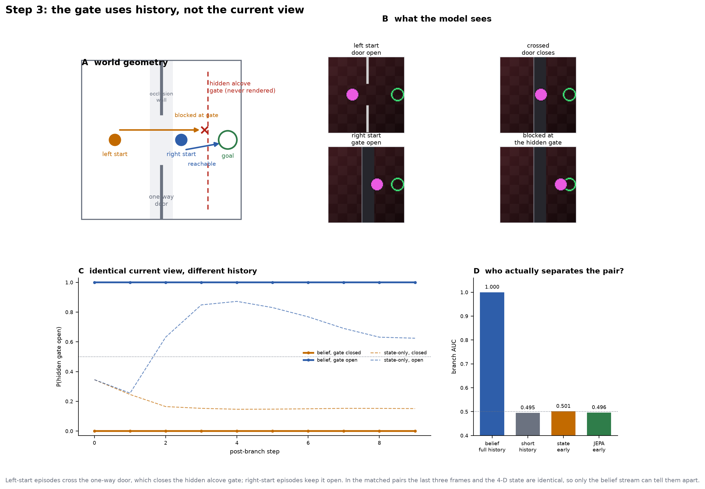
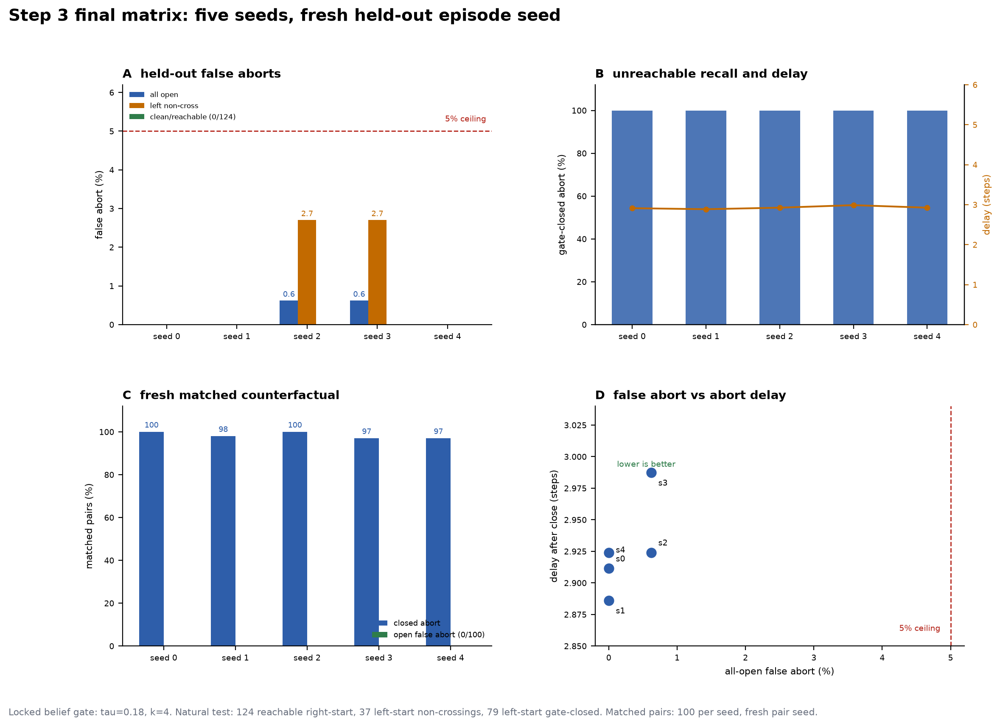

# Closed-loop abort gates — Step 3 final matrix

**Status:** **passes** on a fresh held-out episode seed. Five belief seeds,
locked `τ=0.18, k=4`: all-open false abort **0.0–0.6%**, clean/task-reachable
false abort **0/124** for every seed, gate-closed abort **79/79** for every
seed, delay **2.89–2.99** steps after close. Matched counterfactual branch AUC
**0.9998–1.000**, short-history control **0.494–0.495**, open false abort
**0.00**. 2026-11-12.

**Code:** `scripts/closed_loop_gate.py`,
`scripts/planner_belief_train.py`,
`scripts/matched_cf_closed_loop.py`,
`scripts/controller_probe.py`,
`scripts/counterfactual_seed_check.py`.
**Artifacts:** `runs/planner-belief-hard/`,
`runs/final-gate-s*/`, `runs/final-cf-s*/`,
`runs/final-matrix-report/` (git-ignored).

## 1. Locked protocol

- **Belief training:** 480 planner rollouts from seed 5000; 63 unique
  left-start non-crossing hard negatives (`gate_open=1`) duplicated 2×; 400
  held-out counterfactual pairs; 60 epochs; five model seeds.
- **Calibration:** 160 episodes, seed 7000.
- **Validation:** 240 episodes, seed 9000. Used to fix seed 1 and select
  `(τ,k)`. Not the confirmatory set.
- **Held-out final:** 240 episodes, seed 12000; matched counterfactual pairs
  also seeded 12000.
- **Locked gates:** belief `τ=0.18, k=4`; state `τ=0.25, k=3`; frozen JEPA
  `τ=0.12, k=4`.
- **Task-reachable** means right-start: the puck starts in the right alcove with
  the hidden gate open. Left-start is unreachable by construction: the only
  path to the right alcove crosses the one-way door, which closes the gate.
- Held-out composition: **124 right-start reachable**, **37 left-start
  non-crossing** (task-unreachable, gate still open), **79 left-start crossing**
  (task-unreachable, gate closed).
- Base state-feedback controller: **124/124** on right-start; **0/116** on
  left-start. The quoted 0.770 is 124/161: the denominator contains the 37
  left-start non-crossings.



## 2. Final five-seed natural test (held-out seed 12000)

| seed | false abort (all 161 open) | clean false (124 reachable) | left non-cross false (37) | gate-closed abort (79) | delay after close |
|---:|---:|---:|---:|---:|---:|
| 0 | **0/161 (0.0%)** | **0/124** | 0/37 (0.0%) | **79/79 (100%)** | 2.91 |
| 1 | **0/161 (0.0%)** | **0/124** | 0/37 (0.0%) | **79/79 (100%)** | 2.89 |
| 2 | 1/161 (0.6%) | **0/124** | 1/37 (2.7%) | **79/79 (100%)** | 2.92 |
| 3 | 1/161 (0.6%) | **0/124** | 1/37 (2.7%) | **79/79 (100%)** | 2.99 |
| 4 | **0/161 (0.0%)** | **0/124** | 0/37 (0.0%) | **79/79 (100%)** | 2.92 |
| **mean ± std** | **0.25% ± 0.34%** | **0/124** | **1.08% ± 1.48%** | **100%** | **2.93 ± 0.04** |

All five seeds pass the literal ≤5% all-open bar. The only two false aborts are
left-start non-crossings; no reachable episode is aborted.

### Same test, other gates

| arm | all-open false | clean false | gate-closed abort | delay |
|---|---:|---:|---:|---:|
| state-only | 2/161 (1.24%) | 1/124 (0.81%) | 57/79 (72.2%) | 2.93 |
| frozen JEPA | 11/161 (6.83%) | 1/124 (0.81%) | 23/79 (29.1%) | 3.61 |
| **belief** | **0–1/161 (0–0.62%)** | **0/124** | **79/79 (100%)** | **2.89–2.99** |

The state gate’s low false-abort rate buys a 28% miss on closed gates; the JEPA
gate is worse on both axes.

## 3. Final matched counterfactual (fresh pairs, seed 12000)

Each of 100 pairs has the same goal, nuisance, branch state `[x, y, vx, vy]`,
and byte-identical last three frames. One history crossed the one-way door
(gate closed); the other started right of the door (gate open). Both branches
then run the same controller under their hidden gate status.

| seed | belief branch AUC | short-history control | static state early AUC | static JEPA early AUC | belief closed abort | belief open false abort | delay |
|---:|---:|---:|---:|---:|---:|---:|---:|
| 0 | **1.0000** | 0.4949 | 0.5011 | 0.4960 | 1.00 | **0.00** | 3.00 |
| 1 | **0.9998** | 0.4942 | 0.5011 | 0.4960 | 0.98 | **0.00** | 3.02 |
| 2 | **1.0000** | 0.4950 | 0.5011 | 0.4960 | 1.00 | **0.00** | 3.00 |
| 3 | **1.0000** | 0.4950 | 0.5011 | 0.4960 | 0.97 | **0.00** | 3.01 |
| 4 | **1.0000** | 0.4947 | 0.5011 | 0.4960 | 0.97 | **0.00** | 3.03 |
| **mean ± std** | **1.0000 ± 0.0001** | **0.4948 ± 0.0003** | **0.5011** | **0.4960** | **0.984 ± 0.015** | **0.00** | **3.01 ± 0.01** |

The matched branch static differences are exactly **0.0**. The short-history
control (last three frames only) is at chance, so the belief uses the earlier
crossing history, not the current observation. Over the full post-branch
window, the state gate reaches **0.78 closed / 0.14 open** and JEPA **0.26 /
0.26**, but their early AUCs are chance; they separate only after the closed
branch is physically stuck at the gate.



## 4. What fixed seed 1

On the validation seed 9000, the original 160-rollout/40-epoch recipe gave seed
1 **8.8% all-open / 0% clean / 97.5% gate-closed** at `τ=0.18, k=4`. Its 14
false aborts were all left-start non-crossings. The fixed recipe adds:

- 480 planner rollouts instead of 160, giving **63 unique left-start
  non-crossing hard negatives** instead of roughly 20;
- each hard negative duplicated 2× in the training set (606 total sequences);
- 60 epochs instead of 40;
- the 400 counterfactual pairs unchanged.

On the same validation set, seed 1 then gave **2.5% all-open / 0% clean / 99%
gate-closed**; the other four seeds gave 0–2.5%. All five also held matched
branch AUC 1.000 and open false abort 0.00. The final held-out seed confirms
the fix generalizes.

## 5. Controller probe

The 0.770 base success is a denominator artifact, not a gap-tracking bug:

| controller | right-start success | left-start success | left-start gate closed | total successes |
|---|---:|---:|---:|---:|
| goal-only (current) | **119/119 (1.000)** | 0/121 | 81/121 | 119 |
| staged door waypoint | 118/119 (0.992) | 0/121 | 121/121 | 118 |
| goal-only with true state | 119/119 (1.000) | 0/121 | 82/121 | 119 |

The probe used the validation seed 9000 (119 right-start); the held-out seed
12000 has 124 right-start and the gate report shows the same 124/124 result.
The base controller is perfect on the reachable set. The waypoint controller
crosses every left-start door, but those episodes are still unreachable because
the gate closes; total success does not improve. Leave the controller as-is.

## 6. Verdict

- **Five-seed natural matrix: pass** under the literal all-open ≤5% criterion
  on fresh held-out episodes. Clean/task-reachable false abort is **0/124** for
  every seed; gate-closed abort is **100%** for every seed.
- **Matched counterfactual: pass** for every seed. Belief branch AUC **1.000**,
  short-history and static early controls at chance, open false abort **0.00**,
  closed abort **0.97–1.00**.
- **State-only and frozen-JEPA fail the matched shortcut test**: their early
  AUCs are chance, and their natural closed-gate recall is 72.2% and 29.1%.
- The seed-1 failure was a data-coverage problem, not a metric problem. It was
  fixed by hard negatives without redefining the all-open denominator and
  without an ensemble.

## 7. Reproduce

```sh
# Five belief seeds, final recipe
for s in 0 1 2 3 4; do
  python3 scripts/planner_belief_train.py --seed "$s" \
    --episodes 480 --epochs 60 --hard-repeat 2 \
    --out runs/planner-belief-hard
done

# Held-out natural test, locked (tau,k)
for s in 0 1 2 3 4; do
  python3 scripts/closed_loop_gate.py \
    --belief "runs/planner-belief-hard/belief_s$s.safetensors" \
    --test-episodes 240 --test-seed 12000 \
    --out "runs/final-gate-s$s"
done

# Fresh matched counterfactual pairs
for s in 0 1 2 3 4; do
  python3 scripts/matched_cf_closed_loop.py \
    --belief "runs/planner-belief-hard/belief_s$s.safetensors" \
    --pairs 100 --seed 12000 --out "runs/final-cf-s$s"
done
```

The selected test-grid row is `τ=0.18, k=4` for the belief gate; the state
(`τ=0.25, k=3`) and JEPA (`τ=0.12, k=4`) rows are read from the same report.

## 8. Caveats

- The held-out natural set has 124 reachable and 116 unreachable episodes; the
  37 left-start non-crossings are task-unreachable but keep the gate open.
- The matched counterfactual pairs use controlled branch histories, not natural
  rollouts; the 240-episode natural test covers the natural distribution.
- The gate status is hidden; a manual lock with no history is unobservable to
  every gate.
- The closed-loop controller is a state-feedback heuristic, not a full MPC.
- The ensemble is not used in the matrix. If reported for deployment, keep it
  as an optional extra row.
