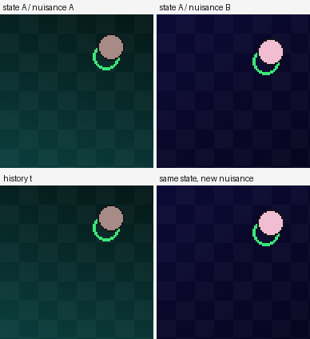

# LeParallax: Positive-Pair Geometry Improves Control and Retention in Action-Conditioned World Models

**Research note / preprint draft.** Not peer reviewed.
Code, pre-registrations, and reproduction scripts:
`github.com/d4vid-le/le-parallax`.

---

## Abstract

The Platonic Representation Hypothesis conjectures that models trained on
different modalities converge to a shared representation of the world. A recent
theorem makes this precise for JEPAs: when positive pairs are two observations of
the same world state with independent nuisance — *good views* — separately trained
encoders agree up to one rotation. The theorem assumes an identity predictor.
Action-conditioned world models, which learn from temporal transitions, are
outside its scope.

We test whether the good-view recipe transfers to a small action-conditioned
world model: a **142,564-parameter** CNN/predictor trained on a synthetic 2D world
with controllable state, nuisance, and dynamics. Across five seeds:

1. **Mechanism.** Good views reduce the same-state nuisance ratio to **0.114** of
   a temporal baseline (95% CI 0.089–0.143, 5/5 seeds) while raising the state
   probe from 0.69–0.87 to 0.90–0.95. Bad views (crops of one observation) are
   **6.71**, worse than temporal.
2. **Control.** With domain-randomized encoders and a fixed state-feedback
   controller, good views improve out-of-distribution success from **68% to
   91%** (**+23 points**, 95% CI +10 to +37, 4/5 seeds, pooled McNemar
   **p = 0.0001**).
3. **Retention.** After adapting to a nuisance shift, good views retain the
   original domain's state probe **+0.229** better (95% CI 0.161–0.298, 5/5) and
   forget **0.025 vs 0.132** (~81% less).
4. **Boundary.** After a **dynamics** shift, good views have no retention
   advantage; they are slightly worse on the original dynamics while both arms
   adapt.

The effect is specific, not a generic “more invariance is better” claim. It also
comes with real failures: one pre-registered state-floor endpoint failed on a
baseline seed, CEM was a broken planner before the control test, a distance
endpoint was near-saturated, and one seed shows a stability–plasticity trade-off.
We report all of them.

---

## 1. Introduction

Joint-Embedding Predictive Architectures (JEPAs) learn by predicting in a compact
latent space rather than reconstructing pixels. The Platonic Representation
Hypothesis (PRH) observes that separately trained vision and language models
become more similar as they scale. A recent theorem turns that observation into a
statement about positive pairs: if two modalities' positives are observations of
the same world state with independent nuisance, their encoders agree up to one
rotation; if the positives are corruptions of one observation, the encoder spends
dimensions on modality nuisance.

The theorem's predictor is the identity. World models such as LeWM, Dreamer, and
V-JEPA-style planners use an action-conditioned predictor over temporal
transitions. That regime is outside the proof:
`(o_t, a_t, o_{t+1})` pairs are two *different* states, not two views of one state.
It is therefore an open empirical question whether good views help a world model,
hurt it, or do nothing.

This note answers that question in a controlled setting. We keep the model small
(142,564 parameters), the world synthetic (a 2D puck with controllable nuisance
and dynamics), and the protocol pre-registered. The contribution is not a new
architecture. It is a set of measurements that separate three claims:

- **Mechanism:** do good views make the latent more state-like?
- **Control:** does that advantage survive into planning/control?
- **Retention:** does it reduce forgetting after a domain shift?
- **Boundary:** is the advantage specific to nuisance, or does it also cover
  dynamics?

The answer is yes, yes, yes, and no. The boundary is the part that makes the
first three credible.

---

## 2. Related work

**Platonic representation and JEPAs.** Huh et al. observed cross-modal
representation convergence with scale. Balestriero and LeCun prove a Platonic
Representation Theorem for JEPAs with shared positives and bound the
misalignment when positives differ; next-token prediction is analyzed as a
bad-view JEPA. LeJEPA introduces SIGReg, the Gaussianity regularizer used here.
LeWM applies a two-term JEPA objective to pixels with an action-conditioned
predictor. Our work uses the same substrate and tests the theorem's uncovered
regime.

**Action-conditioned world models.** Dreamer, TD-MPC, and LeWM learn latent
dynamics for control. Their training signal is transition prediction, not
same-state view invariance. The question of what the latent represents is
usually evaluated post hoc with probes or planning success. We make the
positive-pair definition the independent variable.

**Continual learning and gated adaptation.** Le-Gates, the author's gated
residual adapter family, freezes an old path and learns a scalar-gated residual
for a new domain. In earlier experiments the soft single gate reduced
old-domain drift from +1015% (naive fine-tuning) to +169%, not zero; masked
growable slots reached 0.0025 → 0.0026; hard 0/1 gates with a frozen base gave
zero non-routed forgetting by construction, with a Σ≤1 composition constraint.
Le-Gates is a dynamics-adaptation mechanism. It is not evaluated in this paper;
H3b is the evidence that good views and dynamics adaptation are different
problems.

---

## 3. Method

### 3.1 Synthetic world

A puck moves in a unit square under continuous forces. State
`s = [x, y, vx, vy]`; action `a = [fx, fy]` in `[-1, 1]`; dynamics

```
v' = damping · v + gain · a
x' = clip(x + v', 0.05, 0.95)
```

with walls absorbing normal velocity. The default dynamics are
`[damping=0.85, gain=0.20]`; the dynamics-shift experiment uses `[0.65, 0.32]`.

Observations are 96×96 RGB renders of the puck and a goal ring. Nuisance is
lighting direction/strength, background color, puck color, and camera offset.
Nuisance is sampled independently of state. A **good view** is two renders of the
same state with independent nuisance; a **bad view** is two crops of one render;
a **temporal pair** is `(o_t, a_t, o_{t+1})`.



### 3.2 Model

A three-frame history is encoded by a shared CNN with a spatial-softmax keypoint
head (one expected `(x, y)` per channel), merged into a 64-d latent. A residual
predictor maps `[z, a]` to `z + 0.1·f(z, a)`. The training objective combines:

- next-latent MSE,
- SIGReg,
- variance and covariance terms,
- a contrastive next-latent term,
- a linear state readout,
- a two-step rollout loss.

The full model is **142,564 parameters**. The state readout and two-step loss are
auxiliary objectives shared by every arm; the positive-pair definition is the
only experimental variable.

### 3.3 Training

100 episodes per seed (80 train, 10 validation, 10 test), 32 steps, 96px, 60
epochs, batch 32, AdamW, learning rate 3e-4, five seeds. Good-view arms add a
same-state consistency loss with weight 2.0. Bad-view arms use crop pairs with
the same weight. Domain-randomized encoders use a 50/50 mixture of normal and
shifted nuisance for both arms.

### 3.4 Readout and controller

For control, a ridge readout is fit on augmented latents (normal + shifted
renderings of the same states) and a state-feedback controller is used:

```
a = clip(2 · (goal − predicted_position) − 1.0 · predicted_velocity, −1, 1)
```

for 32 steps, success threshold 0.08. A true-state version of this controller
succeeds 100%; it is the oracle that exposed CEM as the H2 bottleneck.

### 3.5 Protocol

Every confirmatory experiment is pre-registered, hashed, and run on five seeds.
We report per-seed values, paired effect sizes, bootstrap confidence intervals,
and exact McNemar tests where the outcome is binary. Test episodes are fresh and
never used for tuning. The failed endpoints are reported alongside the passes.

---

## 4. Results

### 4.1 Mechanism: good views disentangle state from nuisance

Five seeds, 100 episodes, 96px. Same-state nuisance ratio is the mean distance
between latents of the same state under different nuisance, divided by the mean
distance between different states.

| Arm | Ratio per seed | Mean | State R² per seed | Mean |
|---|---|---:|---|---:|
| Temporal | 2.244, 1.961, 2.804, 3.061, 2.627 | **2.539** | 0.870, 0.687, 0.793, 0.843, 0.859 | **0.810** |
| Good view | 0.287, 0.323, 0.303, 0.282, 0.199 | **0.279** | 0.932, 0.898, 0.945, 0.917, 0.939 | **0.926** |
| Bad view | — | **6.708** | — | 0.606–0.729 |

The good/temporal relative ratio is **0.114** (95% CI 0.089–0.143); 5/5 seeds
are below 0.7. Bad views are **2.6× worse than temporal**, so the effect is not
generic augmentation.

The pre-registered H1b clause required state R² ≥0.75 for both arms in every
seed. Seed 1's temporal baseline is **0.687**, so the literal H1 verdict is
**FAIL** even though the good arm is 0.898 there and higher than temporal in 5/5.
This is a protocol design error: an absolute floor on both arms conflates
baseline variance with treatment harm. H1a and H1c pass; the full H1 claim is not
made.

### 4.2 Control: the advantage survives into behavior

The first control attempt failed because CEM was broken: with true dynamics it
succeeded 28%, random 34%, while a true-state proportional controller succeeded
100%. A second attempt with state-feedback and a linear readout tied at 20%
because the readout had no support for the shifted nuisance. Domain randomization
fixed the support.

H2-v4 uses the frozen domain-randomized encoders, the same readout and
controller, and 20 fresh OOD episodes per seed.

| seed | OOD temporal success | OOD good success | delta |
|---:|---:|---:|---:|
| 0 | 0.60 | 0.95 | +0.35 |
| 1 | 0.50 | 0.95 | +0.45 |
| 2 | 0.75 | 0.95 | +0.20 |
| 3 | 0.90 | 0.90 | +0.00 |
| 4 | 0.65 | 0.80 | +0.15 |

- Mean success delta **+0.23** (95% CI +0.10 to +0.37).
- 4/5 seeds positive.
- Pooled McNemar: good-only 28, temporal-only 5, **p = 0.0001**.
- OOD distance **−0.036**; ID distance **−0.055**; ID success **+0.36**.

The good-view representation-to-control bridge holds under domain randomization.

### 4.3 Retention: less forgetting after a nuisance shift

Frozen H1 encoders adapted to the shifted nuisance with the same 10-epoch
temporal fine-tuning for both arms. A-state R² after adaptation:

| seed | Temporal | Good | Diff | Temporal forget | Good forget |
|---:|---:|---:|---:|---:|---:|
| 0 | 0.783 | 0.897 | +0.114 | +0.074 | +0.028 |
| 1 | 0.728 | 0.909 | +0.180 | +0.085 | +0.023 |
| 2 | 0.654 | 0.921 | +0.267 | +0.071 | +0.037 |
| 3 | 0.661 | 0.898 | +0.237 | +0.173 | +0.022 |
| 4 | 0.578 | 0.925 | +0.347 | +0.255 | +0.015 |

- Mean A post difference **+0.229** (95% CI 0.161–0.298), 5/5.
- Mean forgetting: temporal **0.132**, good **0.025** (~81% less).
- Mean B post difference **+0.005**; seed 4 pays a B-side cost (−0.162) while
  gaining the most on A (+0.347).

This is representation-level retention, not control retention. Forgetting is
reduced, not eliminated.

### 4.4 Boundary: no dynamics protection

Frozen H1 encoders adapted to shifted dynamics `[0.65, 0.32]` with the same
10-epoch objective. Metric: one-step predictor MSE on A/B transitions.

| seed | A temporal post | A good post | diff | A forget temporal | A forget good |
|---:|---:|---:|---:|---:|---:|
| 0 | 0.00461 | 0.00980 | +0.00519 | −0.00098 | +0.00445 |
| 1 | 0.00577 | 0.01049 | +0.00471 | −0.00058 | +0.00481 |
| 2 | 0.00555 | 0.01226 | +0.00672 | +0.00024 | +0.00539 |
| 3 | 0.00490 | 0.01195 | +0.00705 | −0.00087 | +0.00562 |
| 4 | 0.00525 | 0.01289 | +0.00764 | −0.00041 | +0.00635 |

- Mean A post difference (good − temporal) **+0.00626**; good is worse in 5/5.
- Mean A forgetting: temporal **−0.00052**, good **+0.00532**.
- B post difference **−0.00042** (essentially tied); both arms adapt.

Good views buy nuisance invariance, not dynamics immunity. The mechanism is
specific.

---

## 5. What failed, and what it taught

| Experiment | Failure | Lesson |
|---|---|---|
| H1b | Absolute state floor failed on one temporal seed (0.687) | Use relative non-inferiority, not an absolute floor on both arms |
| H2 | CEM with true dynamics 28%, random 34%, P-controller 100% | The planner was the bottleneck, not the representation |
| H2-v2 | State-feedback + linear readout tied at 20%; OOD R² negative | The readout lacked support for the shift |
| H2-v3 | Distance −0.026 vs −0.05 target (fail), success +28 points | The distance endpoint was near-saturated; success was the right control metric |
| H3 seed 4 | Good B post 0.626 vs temporal 0.789 while A gained +0.347 | A real stability–plasticity trade-off, not a free lunch |
| H3b | Good A predictor MSE worse by 0.00626 in 5/5 | Nuisance invariance is not dynamics adaptation |

These failures are part of the contribution. They define the boundary of the
claim and make the surviving results reproducible rather than rhetorical.

---

## 6. Discussion

### 6.1 Positive pairs are a design variable

The practical recipe is cheap: if two observations of the same state with
independently varying nuisance are available, add a same-state consistency term.
It is a representation regularizer, not a new planner. In this world it reduced
nuisance sensitivity by ~89% relative, improved OOD control by 23 points, and
reduced nuisance-shift forgetting by ~81%.

### 6.2 Good views and Le-Gates are complementary

Good views address **nuisance**: what should be invariant. Le-Gates addresses
**dynamics**: what should change and be learned. H3b is the empirical case for
the division of labor: good views do not protect against a dynamics shift, and
adaptation is still required.

The Le-Gates evidence remains bounded: the soft single gate reduced drift from
+1015% to +169% (not zero); masked growable slots reached 0.0025 → 0.0026; hard
gates with a frozen base gave zero non-routed forgetting by construction, with a
Σ≤1 composition constraint. Effective as bounded adaptation/isolation, not as a
no-forgetting guarantee. We did not evaluate Le-Gates here.

### 6.3 Why the effect appears in control only after domain randomization

The first control tests failed because the encoder had never seen the shifted
nuisance; no readout could fix that. Once both arms had support, the good-view
advantage appeared. This is a general caution: representation invariance is not
useful under a distribution the encoder has never seen. Support is a prerequisite,
not a detail.

### 6.4 Limitations

- Synthetic 96px world; one model size (142k); five seeds.
- State readout and two-step loss are auxiliary and shared; this is not a pure
  JEPA ablation.
- H3 is representation-level, not control retention.
- H3b uses predictor MSE, not control.
- One dynamics-shift size; one nuisance-shift distribution.
- No real-world data, language, or cross-modal transfer.
- H1b and H2-v3 are literal failures and remain so.

---

## 7. Conclusion

Same-state good views produce a more world-like latent in an action-conditioned
world model. That latent is more robust to nuisance in control and forgets less
after a nuisance shift, while providing no protection against a dynamics shift.
The effect is large enough to matter in a small simulated world and specific
enough to be falsifiable. Positive-pair geometry is a cheap lever for continual
world models — not a universal invariance fix.

---

## Appendix A — Reproducibility

| Result | Script | Pre-registration |
|---|---|---|
| H1 mechanism | `scripts/h1_confirm.py` | `docs/PREREG-v2.md` |
| H2-v4 control | `scripts/h2v4_success.py` | `docs/PREREG-H2v4.md` |
| H3 retention | `scripts/h3_forgetting.py` | `docs/PREREG-H3.md` |
| H3b boundary | `scripts/h3b_dynamics.py` | `docs/PREREG-H3b.md` |
| Snapshots | `scripts/make_snapshots.py` | — |

Environment: Apple M5 Pro, 64 GB, MLX 0.32.4, Python 3.12. Model: 142,564
parameters. Training is minutes per model at 96px; the full set of reported runs
fits in a few GPU-hours on one machine.

Pre-registration hashes:

```
H1   d08d0d69d24cadd8a2b46a0381056b222a34a7a69fa8bec68dc2ea466c95e411
H2v4 ba4e3c37adcf4a5190394683684e942f382336838628e1f934c4623dac6daf57
H3   c4660371980ef02518b99f9d41c817cc907aa7d67e7a450146f2602e2624f1ec
H3b  eb2a6086b28bca9a44bd430d5d3338455cffc6038afc426b1394301ff30cea1e
```

## Appendix B — Hyperparameters

| Parameter | Value |
|---|---|
| Image size | 96 |
| History | 3 frames |
| Latent | 64 |
| Batch | 32 |
| Optimizer | AdamW |
| Learning rate | 3e-4 (pretrain), 1e-4 (fine-tune) |
| Epochs | 60 (pretrain), 10 (adapt) |
| SIGReg weight | 0.09 |
| Good-view weight | 2.0 |
| Two-step loss weight | 0.5 |
| State-head weight | 0.5 |
| Controller | `k=2`, `damp=1.0`, 32 steps, success 0.08 |
| Readout | ridge, `alpha=1.0` |

## References

- Huh, Cheung, Wang, Isola. *The Platonic Representation Hypothesis.* 2024.
- Balestriero, LeCun. *Proving and Improving the Platonic Representation
  Hypothesis with JEPAs.* arXiv:2610.39302, 2026.
- Balestriero, LeCun. *LeJEPA: Provable and Scalable Self-Supervised Learning
  Without the Heuristics.* arXiv:2511.08544, 2025.
- Maes, Le Lidec, Scieur, LeCun, Balestriero. *LeWorldModel: Stable End-to-End
  Joint-Embedding Predictive Architecture from Pixels.* arXiv:2603.19312, 2026.
- Assran et al. *I-JEPA: Self-Supervised Learning from Images with a Joint-
  Embedding Predictive Architecture.* 2023.
- Bardes et al. *V-JEPA: Latent Video Prediction for Visual Representation
  Learning.* 2023.
- Hafner, Pasukonis, Ba, Lillicrap. *Mastering Diverse Domains through World
  Models.* 2023.
- LeCun. *A Path Towards Autonomous Machine Intelligence.* 2022.
